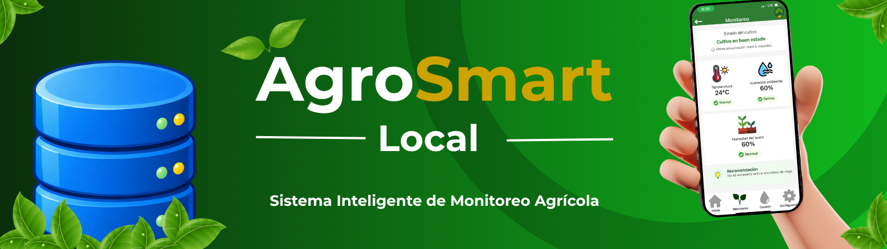
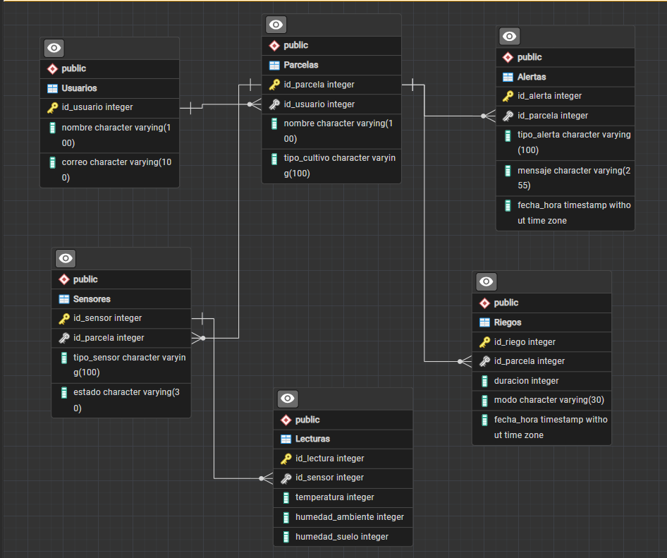

  

<h1 align="center">AgroSmart Local</h1>

  Sistema inteligente de monitoreo agricola 

---
## Contenido

1. [Nombre del proyecto](#1-nombre-del-proyecto)
2. [Descripción](#2-descripción)
3. [Problema que resuelve](#3-problema-que-resuelve)
4. [Solución propuesta](#4-solución-propuesta)
5. [Integrantes](#5-integrantes)
6. [Tecnologías utilizadas](#6-tecnologías-utilizadas)
7. [Funcionalidades principales](#7-funcionalidades-principales)
8. [Estado actual del proyecto](#8-estado-actual-del-proyecto)
9. [Información básica de la base de datos](#9-información-básica-de-la-base-de-datos)
10. [Evidencias](#10-evidencias)
11. [Trabajo colaborativo](#11-trabajo-colaborativo)

## 1. Nombre del proyecto

**AgroSmart Local**: sistema inteligente de monitoreo agrícola.

## 2. Descripción

AgroSmart Local es un sistema de monitoreo agrícola que permite registrar y consultar información de **usuarios, parcelas, sensores, lecturas, riegos y alertas**. Está formado por:

- una **aplicación móvil** desarrollada en MIT App Inventor
- una **base de datos PostgreSQL** que organiza la información del sistema.

## 3. Problema que resuelve

Muchos pequeños agricultores no cuentan con herramientas accesibles para revisar, desde su teléfono, variables como la **humedad del suelo** o la **temperatura**, ni para organizar en un solo lugar la información de sus distintas parcelas. Esto los obliga a estar físicamente en la parcela de forma constante para saber si el cultivo necesita riego.

## 4. Solución propuesta

Una aplicación móvil sencilla y una base de datos que organiza su información. Con la aplicación, el usuario puede:

1. Crear una cuenta e iniciar sesión.
2. Registrar hasta **tres parcelas**, cada una con su tipo de cultivo.
3. Consultar el estado del cultivo (humedad del suelo, temperatura y humedad ambiental) con una recomendación según los rangos definidos.
4. Recibir alertas según su prioridad.
5. Activar o detener el riego de forma manual.

La base de datos PostgreSQL almacena de forma ordenada y relacionada a los usuarios, sus parcelas, los sensores, las lecturas, los riegos y las alertas.

## 5. Integrantes

| Integrante | Rama de trabajo | Responsabilidad |
|---|---|---|
| Gissel Adayari Díaz López | `usuarios-parcelas` | Usuarios y parcelas |
| Leonardo Abisaí Funez Zetino | `sensores-lecturas` | Sensores y lecturas |
| Ariana Valeria Arias Henriquez | `riegos-alertas` | Riegos y alertas |

## 6. Tecnologías utilizadas

| Tecnología | Uso dentro del proyecto |
|---|---|
| MIT App Inventor | Desarrollo de la aplicación móvil |
| PostgreSQL 18 | Gestión y almacenamiento de la base de datos |
| pgAdmin 4 | Administración de la base de datos y ejecución de consultas |
| Git y GitHub | Control de versiones y trabajo colaborativo |

---

## 7. Funcionalidades principales

- **Cuentas de usuario:** registro con validación de campos e inicio de sesión.
- **Gestión de parcelas:** registrar, editar y eliminar hasta tres parcelas, con su tipo de cultivo, mostradas en tarjetas con la imagen del cultivo.
- **Perfil:** foto de perfil tomada con la cámara, edición de nombre y correo, y cierre de sesión.
- **Monitoreo del cultivo:** humedad del suelo, temperatura y humedad ambiental, con estado y recomendación según rangos definidos.
- **Alertas:** clasificadas por prioridad (alta, media o ninguna).
- **Control de riego:** activación y detención manual con tiempos predefinidos.
- **Configuración:** sonido, alertas y conexión Bluetooth.

## 8. Estado actual del proyecto

Primera entrega: **avance técnico** (octubre de 2026).

| Funcionalidad | Estado |
|---|---|
| Registro de usuarios e inicio de sesión | ✅ Implementada |
| Gestión de parcelas (registrar, editar, eliminar) | ✅ Implementada |
| Perfil de usuario | ✅ Implementada |
| Configuración | ✅ Implementada |
| Base de datos PostgreSQL (seis tablas, datos de prueba y consultas) | ✅ Implementada |
| Monitoreo del cultivo | 🔧 En desarrollo |
| Alertas | 🔧 En desarrollo |
| Control de riego | 🔧 En desarrollo |
| Monitoreo por parcela y vinculación sensor–parcela | 🔧 En desarrollo |
| Historial de lecturas y gráficas | 📅 Planificada |

## 9. Información básica de la base de datos

| Dato | Valor |
|---|---|
| Gestor | PostgreSQL 18 |
| Administración | pgAdmin 4 |
| Nombre de la base | `AgroSmart_BD` |
| Tablas | 6 |
| Datos de prueba | Ficticios: 3 usuarios, 7 parcelas, 2 sensores, 4 lecturas, 3 riegos y 2 alertas |

### Tablas

| Tabla | Qué almacena | Campos principales |
|---|---|---|
| **Usuarios** | Los usuarios registrados | `id_usuario`, `nombre`, `correo`, `contrasena`, `foto_perfil` |
| **Parcelas** | Las parcelas de cada usuario y su cultivo | `id_parcela`, `id_usuario`, `nombre`, `tipo_cultivo` |
| **Sensores** | Los sensores de cada parcela | `id_sensor`, `id_parcela`, `tipo_sensor`, `estado` |
| **Lecturas** | Los valores que registra cada sensor | `id_lectura`, `id_sensor`, `temperatura`, `humedad_ambiente`, `humedad_suelo` |
| **Riegos** | Las acciones de riego de cada parcela | `id_riego`, `id_parcela`, `duracion`, `modo`, `fecha_hora` |
| **Alertas** | Los avisos generados para cada parcela | `id_alerta`, `id_parcela`, `tipo_alerta`, `mensaje`, `fecha_hora` |

### Relaciones

- Un **usuario** tiene muchas **parcelas**.
- Una **parcela** tiene muchos **sensores**, **riegos** y **alertas**.
- Un **sensor** genera muchas **lecturas**.

Al eliminar una parcela se eliminan también sus sensores, lecturas, riegos y alertas (eliminación en cascada). El correo de cada usuario es único, sin distinguir mayúsculas.

### Modelo físico

El modelo físico representa la estructura de la base de datos, sus campos, claves y relaciones entre las diferentes tablas.

  

### Cómo crear la base de datos

1. En pgAdmin 4, crea una base de datos llamada `AgroSmart_BD`.
2. Clic derecho sobre la base → **Query Tool**.
3. Abre y ejecuta, en este orden, los scripts de [`base_de_datos/`](base_de_datos):
   1. `01_crear_tablas.sql`: crea las seis tablas.
   2. `02_datos_prueba.sql`: inserta los datos de prueba.
   3. `03_consultas.sql`: consultas `SELECT`, `INSERT`, `UPDATE` y `DELETE` de ejemplo.

## 10. Evidencias

El detalle del avance y las capturas que lo respaldan están en el repositorio.

| Evidencia | Ubicación |
|---|---|
| Documento de avance técnico | [`documentacion/`](documentacion) |
| Capturas de la aplicación, la base de datos, las pruebas y GitHub | [`evidencias/`](evidencias) |
| Scripts SQL (tablas, datos de prueba y consultas) | [`base_de_datos/`](base-datos) |
| Modelo físico de la base de datos | [`modelo/`](modelo) |
| Proyecto de la aplicación (`.aia`) | [`app/`](app) |

## 11. Trabajo colaborativo

El proyecto se desarrolla en GitHub con ramas independientes para repartir las tareas.

| Rama | Uso |
|---|---|
| `main` | Rama principal: versión estable del proyecto |
| `usuarios-parcelas` | Trabajo de Gissel Díaz |
| `sensores-lecturas` | Trabajo de Leonardo Funez |
| `riegos-alertas` | Trabajo de Valeria Arias |

Cada integrante trabaja en su rama y, cuando su parte está probada, se integra a `main` mediante un Pull Request.

---

**Instituto Católico Karol Wojtyla** · Tercer Año de Bachillerato Técnico Vocacional en Desarrollo de Software · Módulo DS
Docente: Lic. Criseyda Guadalupe Araujo Melgar
